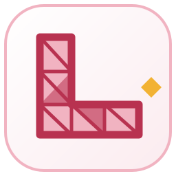
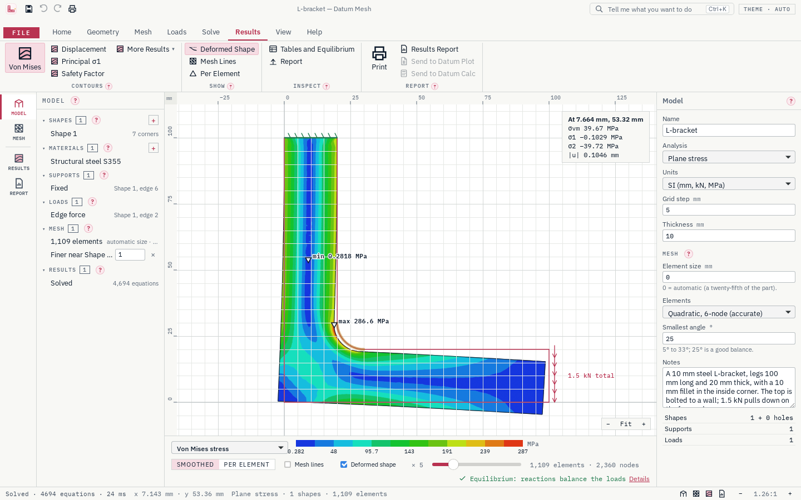

<p align="center"></p>

<h1 align="center">Datum Mesh</h1>

<p align="center">Finite-element analysis on the desktop: stresses, deflections and temperatures in parts and frames.</p>

<p align="center">
  <a href="https://github.com/Edgar-Mendonca/Datum-Mesh/releases"></a>
  <a href="https://github.com/Edgar-Mendonca/Datum-Mesh/actions/workflows/ci.yml"></a>
  <a href="https://github.com/Edgar-Mendonca/Datum-Mesh/releases"></a>
  
  
  
  
  
</p>

<p align="center">
  <a href="https://github.com/Edgar-Mendonca/Datum-Mesh/releases/latest"></a>
  <a href="CHANGELOG.md"></a>
  <a href="docs/MEMORY.md"></a>
</p>



**Purpose:** To show any engineer or student how a part or structure carries load, heat and vibration (where it is stressed, how far it moves, how hot it gets) in a free app they can trust because it proves its own answers.

Draw a frame of beams and truss bars, or the outline of a part with its holes; put on the supports and loads; solve, and see the deflections, stresses and temperatures. Datum Mesh is for mechanical, structural, process and aerospace engineers, students and lecturers. It is free and open source (MIT), Windows first, installs in seconds and updates itself. More on the family site: [edgar-mendonca.github.io/Datum/apps/mesh](https://edgar-mendonca.github.io/Datum/apps/mesh).

## What it does

- **Frames and trusses, solved**: draw beams and truss bars on a grid, put on supports and loads, press Solve (F5). See the deflected shape, the moment, shear and axial diagrams, the reactions, stresses and utilisation; hover a member to read the values there.
- **Parts, meshed and solved**: plane stress, plane strain, axisymmetric solids (vessels, shafts), steady heat conduction and thermal stress on automatic triangle meshes (6-node by default), finer where you ask. Contours of von Mises and principal stress, displacement, safety factor, temperature and heat flux; the deformed shape; hover anywhere to read the values.
- **Natural frequencies** and mode shapes of frames and parts, moving on screen.
- **Buckling of frames**: load factors and buckled shapes, with every squeezed truss bar checked as a strut.
- **3D solids**: a part's section extruded by its thickness or revolved about an axis (shafts, hubs, vessels), solved in 3D for stress, natural frequencies or heat conduction, coloured in a 3D view, with a cutting plane to see inside; faces picked by clicking them.
- **3D frames and trusses**: drawn on front, side and plan planes, repeated into bays, seen in a 3D view and coloured by their results, with natural frequencies and buckling.
- **The equilibrium check** after every solve (the heat balance for heat models), and **Help › Verification**: 131 benchmark checks with known answers solved in front of you, from beam theory, Euler columns and 3D frames to the plate with a hole, the thick cylinder, NAFEMS LE1 and LE10 and conduction through a fin, with mesh convergence.
- **Materials** from Datum Atlas (54 metals and plastics), each with its source.
- **Sections** (rectangle, round bar, tube, box, I, channel, angle, or your own values) with their properties worked out, and European steel tables (IPE, HEA, HEB).
- **Load cases and combinations** with your own factors, an envelope of every member's forces over all combinations, and **hinged member ends**.
- **Drawing parts**: rectangles, circles and polygons with arc edges, and holes; slots, rounded rectangles and regular polygons; rounded and bevelled corners; union, subtract and intersect with arcs kept true; offsets and patterns of holes; supports and loads on edges and points, including a pin load that bears on one side of a hole.
- **Units**: SI (mm, kN, MPa) or US (in, kip, ksi); files keep SI.
- **Worked examples**: a portal frame, a roof truss, a braced steel frame with load cases, a steel platform in 3D, a lifting lug, an L-bracket with a fillet, a flange plate, a heat sink (also in 3D), a pressure vessel (also revolved in 3D) and a heated plate.
- **Print to PDF**: the model with a title block and a report with the mesh, contour pictures, the largest values, reactions and the equilibrium check; a `?` card beside every tool, light and dark themes, recovery of unsaved work, updates from inside the app.

| Release | What arrives |
| --- | --- |
| 0.3.5 | DXF import, a quicker solver for large 3D models |
| 0.4 | STEP import of any 3D part (with an open mesher in the installer), then yielding, large deflection and contact |

Everything is computed by Datum Mesh's own engine in Rust (`crates/core`), with tests against known answers.

## Build it

```bash
npm ci
npm run build:ui
cargo run -p datum-mesh          # the app
cargo test --workspace           # the engine's tests
npm run test:ui                  # the window's tests
```

Datum Mesh is part of the [Datum family](https://edgar-mendonca.github.io/Datum/) of free desktop tools for engineers, scientists, researchers and analysts. MIT licence.
