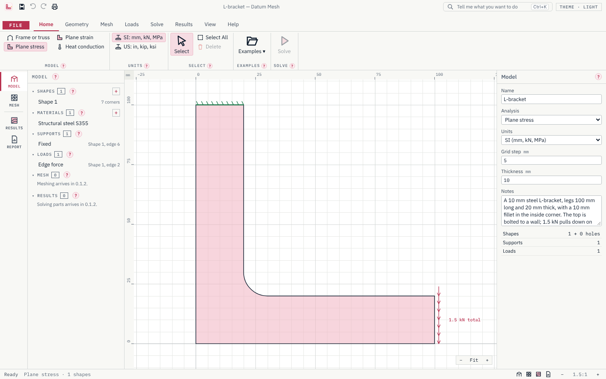

<p align="center"></p>

<h1 align="center">Datum Mesh</h1>

<p align="center">Finite-element analysis on the desktop: stresses, deflections and temperatures in parts and frames.</p>

<p align="center">
  <a href="https://github.com/Edgar-Mendonca/Datum-Mesh/releases"></a>
  <a href="https://github.com/Edgar-Mendonca/Datum-Mesh/actions/workflows/ci.yml"></a>
  <a href="https://github.com/Edgar-Mendonca/Datum-Mesh/releases"></a>
  
  
  
  
  
</p>

<p align="center">
  <a href="https://github.com/Edgar-Mendonca/Datum-Mesh/releases/latest"></a>
  <a href="CHANGELOG.md"></a>
  <a href="docs/MEMORY.md"></a>
</p>



Draw a frame of beams and truss bars, or the outline of a part with its holes; put on the supports and loads; solve, and see the deflections, stresses and temperatures. Datum Mesh is for mechanical, structural, process and aerospace engineers, students and lecturers. It is free and open source (MIT), Windows first, installs in seconds and updates itself. More on the family site: [edgar-mendonca.github.io/Datum/apps/mesh](https://edgar-mendonca.github.io/Datum/apps/mesh).

## What it does

**0.1.0** (today) is the window and the drawing canvas; solving arrives over the next releases:

- **Frames and trusses**: beams and truss bars on a grid with snap and rulers; sections (rectangle, round bar, tube, box, I, channel, angle, or your own values) with their properties worked out.
- **Parts**: rectangles, circles and polygons with arc edges, and holes; plane stress, plane strain and heat conduction.
- **Supports and loads** on nodes, members and edges: fixed, pinned, rollers, springs, symmetry; forces, moments, distributed loads, pressure, gravity; temperatures, heat flux and convection.
- **Units**: SI (mm, kN, MPa) or US (in, kip, ksi); files keep SI.
- **Worked examples**: a portal frame, a roof truss, a lifting lug, an L-bracket with a fillet, a flange plate and a heat sink.
- **Print to PDF** with a title block, a `?` card beside every tool, light and dark themes, recovery of unsaved work, updates from inside the app.

| Release | What arrives |
| --- | --- |
| 0.1.1 | Frames and trusses solved: deflected shape, axial, shear and moment diagrams, reactions, the equilibrium check |
| 0.1.2 | Parts meshed (6-node triangles) and solved: stress and displacement contours, deformed shape, probe |
| 0.1.3 | Heat conduction, the materials library from Datum Atlas, the results report and **Help › Verification**: every benchmark with Datum Mesh's answer, the reference and the error |

Everything is computed by Datum Mesh's own engine in Rust (`crates/core`), with tests against known answers.

## Build it

```bash
npm ci
npm run build:ui
cargo run -p datum-mesh          # the app
cargo test --workspace           # the engine's tests
npm run test:ui                  # the window's tests
```

Datum Mesh is part of the [Datum family](https://edgar-mendonca.github.io/Datum/) of free desktop tools for engineers, scientists, researchers and analysts. MIT licence.
